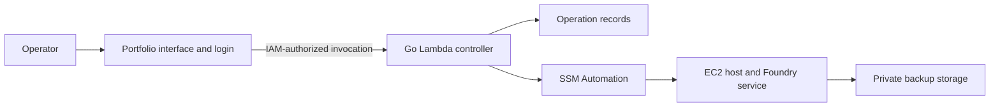

# Use a Go Lambda controller with Systems Manager Automation

> **Recovery storage superseded on 2026-09-28** by aws-setup
> [aws-design §6.2 and §9.3](https://github.com/CraigDevJohnson/aws-setup/blob/main/aws-design.md#93-backups-and-recovery):
> Data Lifecycle Manager snapshots replace the S3 recovery sets, legal holds and
> governance-locked AWS Backup vaults described below. The controller direction
> stands.

Use a privately invoked Go Lambda controller and Systems Manager Automation
runbooks, with Terraform defining the infrastructure and service setup. This
fits the portfolio's existing Go and AWS integration and keeps management
available while the game host is stopped. Native EC2 maintenance actions avoid
building a persistent worker or a custom polling engine for one host.

## Responsibilities and resources

- The portfolio authenticates the sole operator, collects interruption
  confirmations, and invokes the backend server-side. Actor identity comes
  from its authenticated session; the backend authenticates the portfolio's
  IAM role, not a browser-supplied email.
- The controller accepts a fixed set of actions for the configured host and
  returns a durable operation ID. An on-demand DynamoDB table admits one
  mutating operation at a time and records idempotency and operation metadata.
- SSM Automation performs instance transitions, waits for host readiness, and
  invokes fixed host commands. Native actions keep long waits outside Lambda.
- Host commands use a consistent service lifecycle, serialize mutations, and
  preserve operation evidence. Unknown outcomes must be reconciled before
  retrying; an expired lease alone does not prove an earlier operation stopped.
- Private S3 storage holds complete recovery sets with integrity checks and
  software/setup metadata. The host may upload backups but may not delete
  retained recovery points; retention belongs to the management plane. The
  dedicated session series follows the
  [legal-hold exception](0004-session-archive-protection.md), while scheduled
  recovery points remain in governance-locked AWS Backup vaults.
- Terraform defines the host, service dependencies, controller, runbooks, roles,
  storage, and operation records. Its state and recovery secrets require private
  storage and must remain outside Git and job output.

The portfolio must lose direct EC2 lifecycle authority for this Foundry instance
when the backend takes ownership, including through its existing generic routes.
This enforces the backup-before-stop rule across the management interface.

## Alternatives and cost

Standard Step Functions is a viable alternative with visual workflow execution,
but the required instance transitions and fixed commands fit SSM Automation's
native actions. Direct Run Command alone would leave more admission, waiting,
and recovery behavior in custom application code.

These additions charge mainly for backup storage, Automation steps,
Lambda/database requests, and bounded logs. Restore drills temporarily add an
isolated EC2 instance and its volumes. There is no requirement for another
always-running server, public API, NAT gateway, or load balancer. A costed
resource plan and an adoption/rollback procedure are required before deployment.

At an illustrative 2.5 GiB per complete recovery set, three session backups
in two Regions require 15 GiB before a temporary fourth copy, retained object
versions, pre-upgrade copies, and ordinary 30-day scheduled recovery points.
The earlier 10-session, single-Region storage example is superseded; no revised
dollar total or spending cap is adopted. Before deployment, itemize measured
backup size and frequency, storage in both Regions, copy and request charges,
encryption, operation records, Automation, Lambda, logs, held versions, and
isolated restore drills. Use current
[S3](https://aws.amazon.com/s3/pricing/),
[AWS Backup](https://aws.amazon.com/backup/pricing/), and
[Automation](https://aws.amazon.com/systems-manager/pricing/) prices.

An isolated drill also consumes temporary instance, volume, and public IPv4
resources for its duration, plus workflow and request costs; the restore target
must remain isolated from players. The
[hosting baseline](../hosting-baseline.md) records the existing host footprint,
not a price for the revised recovery design. Additional held backups, growing
world data, retained object versions, logs, or longer drills increase cost.

Craig accepted the serverless management backend architecture on 2026-09-08.
He separately accepted the three-session archive and legal-hold protection
exception on 2026-09-24 in the
[Issue #12 supplement](https://github.com/CraigDevJohnson/aws-setup/issues/12#issuecomment-5824745778).
Neither decision authorizes AWS execution. Implementation and live adoption
remain subject to the first-release specification and its verification gates.

## Sources

- [SSM instance state transitions](https://docs.aws.amazon.com/systems-manager/latest/userguide/automation-action-changestate.html)
- [SSM readiness waits](https://docs.aws.amazon.com/systems-manager/latest/userguide/automation-action-waitForAwsResourceProperty.html)
- [SSM fixed-command actions](https://docs.aws.amazon.com/systems-manager/latest/userguide/automation-action-runcommand.html)
- [Automation execution and idempotency](https://docs.aws.amazon.com/systems-manager/latest/APIReference/API_StartAutomationExecution.html)
- [Systems Manager pricing](https://aws.amazon.com/systems-manager/pricing/)
