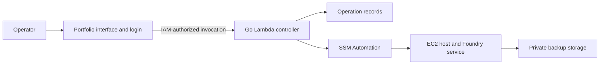

# Use a Go Lambda controller with Systems Manager Automation

Use a privately invoked Go Lambda controller and Systems Manager Automation
runbooks, with Terraform defining the infrastructure and service setup. This
fits the portfolio's existing Go and AWS integration and keeps management
available while the game host is stopped. Native EC2 maintenance actions avoid
building a persistent worker or a custom polling engine for one host.

## Responsibilities and resources

- The portfolio authenticates the sole operator, collects interruption
  confirmations, and invokes the backend server-side. Actor identity comes
  from its authenticated session; the backend authenticates the portfolio's
  IAM role, not a browser-supplied email.
- The controller accepts a fixed set of actions for the configured host and
  returns a durable operation ID. An on-demand DynamoDB table admits one
  mutating operation at a time and records idempotency and operation metadata.
- SSM Automation performs instance transitions, waits for host readiness, and
  invokes fixed host commands. Native actions keep long waits outside Lambda.
- Host commands use a consistent service lifecycle, serialize mutations, and
  preserve operation evidence. Unknown outcomes must be reconciled before
  retrying; an expired lease alone does not prove an earlier operation stopped.
- Private S3 storage holds complete recovery sets with integrity checks and
  software/setup metadata. The host may upload backups but may not delete
  retained recovery points; retention belongs to the management plane.
- Terraform defines the host, service dependencies, controller, runbooks, roles,
  storage, and operation records. Its state and recovery secrets require private
  storage and must remain outside Git and job output.

The portfolio must lose direct EC2 lifecycle authority for this Foundry instance
when the backend takes ownership, including through its existing generic routes.
This enforces the backup-before-stop rule across the management interface.

## Alternatives and cost

Standard Step Functions is a viable alternative with visual workflow execution,
but the required instance transitions and fixed commands fit SSM Automation's
native actions. Direct Run Command alone would leave more admission, waiting,
and recovery behavior in custom application code.

These additions charge mainly for backup storage, Automation steps,
Lambda/database requests, and bounded logs. Restore drills temporarily add an
isolated EC2 instance and its volumes. There is no requirement for another
always-running server, public API, NAT gateway, or load balancer. A costed
resource plan and an adoption/rollback procedure are required before deployment.

For planning, 10 session backups plus two held pre-upgrade copies at 2.5 GiB
each would retain 30 GiB, costing approximately $0.69/month in S3 Standard.
Forty workflows with 10 initiated native Automation steps each would add
$0.80/month. This $1.49 subtotal excludes requests, operation metadata, Lambda,
logs, and restore drills. A provisional $2–$5/month incremental allowance is
reasonable for this example; it is a recommendation, not an agreed cap or a
guaranteed bill. See the
[Oregon S3 price list](https://pricing.us-east-1.amazonaws.com/offers/v1.0/aws/AmazonS3/current/us-west-2/index.csv)
and [Automation pricing](https://aws.amazon.com/systems-manager/pricing/).

A four-hour drill with one `t4g.small`, 30 GiB baseline gp3, and one public IPv4
would cost about $0.10 for those resources if they stop accruing charges after
four hours, plus workflow and request costs. This is a resource-cost example;
the restore target must remain isolated from players. Rates are recorded in the
[hosting baseline](../hosting-baseline.md). Additional held backups, growing
world data, retained object versions, logs, or longer drills increase cost;
these examples use no free-tier credit.

Craig accepted this architecture on 2026-09-08. Implementation and live adoption
remain subject to the first-release specification and its verification gates.

## Sources

- [SSM instance state transitions](https://docs.aws.amazon.com/systems-manager/latest/userguide/automation-action-changestate.html)
- [SSM readiness waits](https://docs.aws.amazon.com/systems-manager/latest/userguide/automation-action-waitForAwsResourceProperty.html)
- [SSM fixed-command actions](https://docs.aws.amazon.com/systems-manager/latest/userguide/automation-action-runcommand.html)
- [Automation execution and idempotency](https://docs.aws.amazon.com/systems-manager/latest/APIReference/API_StartAutomationExecution.html)
- [Systems Manager pricing](https://aws.amazon.com/systems-manager/pricing/)
